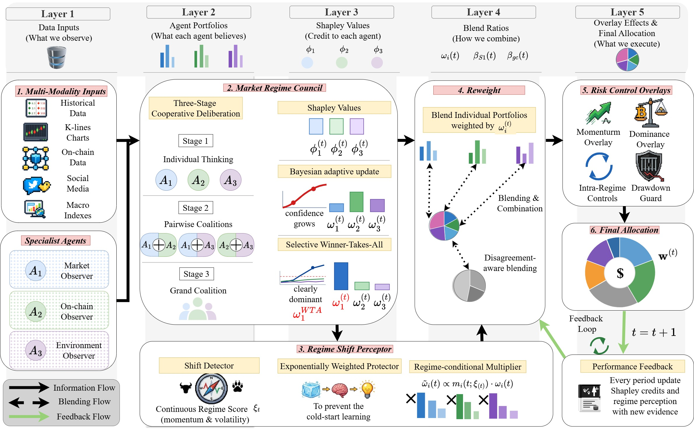

# Market Regime Council for Dynamic Credit Assignment in Multi-Agent LLM Decision Systems

Code for the NeurIPS 2026 paper by Yunhua Pei, Zerui Ge, Jin Zheng and John Cartlidge.
Paper: https://arxiv.org/abs/2605.24490

Market Regime Council (MRC) assigns credit across specialist LLM agents with exact Shapley values,
computed online over all single, pairwise and grand-coalition portfolios, and turns that credit into
agent weights for daily crypto portfolio decisions over 13 assets.



## Installation

```bash
pip install -r requirements.txt   # tested with Python 3.8
```

Smoke test, with no data, GPU or API key needed:

```bash
python run_backtest.py --mock --run-mode mrc --start 2023-03-01 --end 2023-03-20
```

## Data

- `data/final_data_info.xlsx`: every data source, with its indicators, links and date ranges.
- `data/DATA_FORMAT.md`: where each file goes and its columns.
- `data/samples/`: short excerpts showing each format.

The raw files come from the public providers listed in the spreadsheet and are not redistributed here.

## Running

Main experiments (local Ollama, `qwen3-vl:8b`, about 7 hours per run on one RTX 3090):

```bash
ollama pull qwen3-vl:8b        # with an Ollama server running (ollama serve)
python run_backtest.py --run-mode mrc --model-name qwen3-vl:8b --temperature 0.7 \
    --start 2023-03-01 --end 2025-12-31
```

Set `--temperature 0.7` explicitly, since the command-line default is 0.9. The paper reports the
mean and standard deviation over five runs.

Other backends, e.g. the Qwen3-VL variants of the backbone ablation via OpenRouter:

```bash
python run_backtest.py --use-openrouter --api-key $OPENROUTER_API_KEY --model-name qwen/qwen3-vl-32b-instruct ...
python run_backtest.py --use-local-llm --api-base http://localhost:8000/v1 --model-name <model> ...
```

Baselines:

```bash
# DRL baselines (no LLM calls; --mock skips the LLM connection check)
python run_backtest.py --mock --run-mode baselines --drl-baselines a2c ppo dqn mappo maddpg \
    --start 2023-03-01 --end 2025-12-31
# MRC with the LLM baselines
python run_backtest.py --run-mode all --baselines fincon trading_agents finmem cryptotrade fs_reasoning \
    --start 2023-03-01 --end 2025-12-31
```

Each run writes its logs, per-period records and a return plot to `logs/`. If an LLM call fails,
that day uses an equal-weight portfolio and the log shows `[Backtest] Council failed on <date>`.

## Code map

- `market_regime_council/council/shapley_tracker.py`: coalition values, exact Shapley values, Bayesian mixture, selective WTA
- `market_regime_council/council/regime_council.py`: three-stage council, regime-aware multipliers, blend ratios
- `market_regime_council/backtest/backtest_runner.py`: daily loop, execution overlays, EMA smoothing
- `market_regime_council/agents/`, `prompts/`: the specialist agents, the Agent-4 readout and all prompts
- `market_regime_council/baselines/`: FinCon, TradingAgents, FinMem, CryptoTrade, FS-ReasoningAgent, A2C, PPO, DQN, MAPPO, MADDPG

## Acknowledgements

This work was funded by UKRI EPSRC (grant No. EP/Y028392/1): AI for Collective Intelligence (AI4CI).

## License

MIT, see `LICENSE`.

## Citation

```bibtex
@article{pei2026market,
  title={Market Regime Council for Dynamic Credit Assignment in Multi-Agent LLM Decision Systems},
  author={Pei, Yunhua and Ge, Zerui and Zheng, Jin and Cartlidge, John},
  journal={arXiv preprint arXiv:2605.24490},
  year={2026}
}
```
